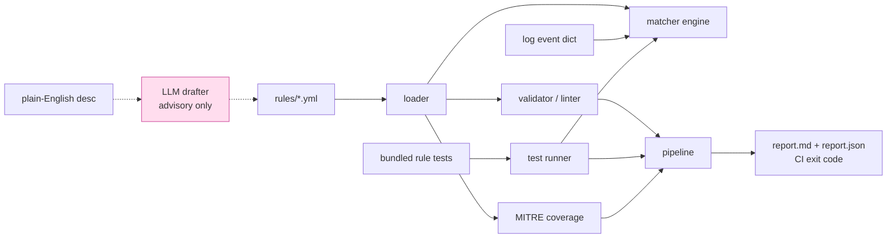

# detection-as-code-pipeline

**Treat SIEM detection rules like software: version them as YAML, lint them, unit-test them against sample log events, and fail CI when a rule breaks.** Every rule maps to MITRE ATT&CK, so you get a coverage view for free.

## The problem

Detection content usually lives as clicked-together queries inside a SIEM: no review, no tests, no version history, and no easy answer to "which ATT&CK techniques do we actually cover?" When someone edits a rule, nothing catches the regression until an alert silently stops firing.

## What it does

- **Rules as YAML** — a small, documented, Sigma-inspired schema: `id`, `title`, `severity`, `logsource`, a `detection` block (field operators `equals` / `contains` / `startswith` / `re` / `in`, combined by a `condition` like `selection and not filter`), plus `mitre` (tactic + technique) and `false_positives`. Ships 5 realistic rules.
- **Deterministic matcher** — given a rule and one log event (a dict), decide match / no-match. No LLM, no network. This is the core.
- **Unit tests for detections** — each rule carries `tests`: sample events labelled should-match / should-not-match. The runner asserts the matcher's verdict equals the label.
- **Validator / linter** — schema checks, required MITRE mapping, unique ids, unknown-operator and bad-regex detection, undefined selection references. Non-zero exit = CI gate.
- **Pipeline** — runs lint + rule-tests, aggregates MITRE coverage, prints a summary, and writes `report.md` + `report.json`.
- **`scan`** — run every rule over a JSON file of events and print the alerts (demo of the matcher on data).
- **AI helper (optional)** — `draft` turns a plain-English description into a rule skeleton via a local LLM. Output is clearly labelled AI-generated and advisory; the matcher and validator never use AI.

## Architecture



## Quickstart

```bash
# 1) install deps (PyYAML + pytest)
make install            # or: pip install -r requirements.txt && pip install -e .

# 2) run the offline test gate
make test               # pytest -q

# 3) run the full pipeline on the bundled rules
make run                # python -m detection_as_code pipeline  -> reports/report.md

# 4) try the matcher on sample events
python -m detection_as_code scan

# 5) (optional, needs a local LLM) draft a rule from English
python -m detection_as_code draft "powershell downloading from a pastebin url"
```

No install needed to run: `./run.sh pipeline` works from a fresh checkout (just needs PyYAML).

### Install as a CLI

```bash
pipx install git+https://github.com/aminafara123/detection-as-code-pipeline
detection-as-code pipeline
detection-as-code scan
detection-as-code lint
```

## Sample run

```text
$ python -m detection_as_code pipeline
pipeline: 5 rules | 0 lint errors | 14/14 tests passed | 5 tactics, 5 techniques covered
gate: PASS  (report -> reports)

$ python -m detection_as_code scan
ALERT event#0  [HIGH] Brute Force Logon Attempts (Failed Windows Logons)  (Credential Access T1110)
ALERT event#3  [HIGH] Suspicious PowerShell Execution  (Execution T1059.001)
ALERT event#5  [MEDIUM] Impossible Travel (Geo-Velocity Anomaly)  (Initial Access T1078)
ALERT event#7  [HIGH] User Added to a Privileged Group  (Persistence T1098)
ALERT event#9  [MEDIUM] Potential Data Exfiltration to Personal File-Sharing  (Exfiltration T1567.002)
scan: 11 event(s), 5 alert(s)
```

A broken rule (bad severity, missing MITRE id, unknown operator, duplicate id, a rule-test whose expected verdict no longer holds) makes `lint` / `test` / `pipeline` exit non-zero, so it fails the CI job.

### Rule shape (excerpt)

```yaml
id: win-suspicious-powershell
title: Suspicious PowerShell Execution
severity: high
logsource: {product: windows, service: sysmon}
detection:
  selection_proc:
    image|contains: powershell
  selection_flags:
    command_line|contains: [-enc, -EncodedCommand, DownloadString, IEX]
  condition: selection_proc and selection_flags
mitre: {tactic: Execution, technique: T1059.001}
tests:
  - {name: encoded command matches, event: {image: powershell.exe, command_line: "powershell -enc ..."}, should_match: true}
  - {name: plain powershell, event: {image: powershell.exe, command_line: "powershell Get-Process"}, should_match: false}
```

## How it works

1. `rules.load_rules` parses every `*.yml` under `detection_as_code/rules/`.
2. `rules.validate_ruleset` lints each rule plus cross-rule checks (unique ids).
3. `matcher.match` evaluates each selection's field tests (AND within a selection, list values are OR), then combines the selections with the `condition` grammar (`and` / `or` / `not` / parentheses, or `all of them` / `any of them`).
4. `pipeline.run_rule_tests` runs every rule's bundled tests through the matcher; `pipeline.mitre_coverage` rolls up tactics/techniques; `pipeline.build_report` + `report_markdown` write the report and set the exit code.

String comparisons (`equals`, `contains`, `startswith`, `in`) are case-insensitive; `re` is applied as written. The matcher is single-event by design: counting / time-window correlation (e.g. "N failed logons in 5 minutes") is left to the SIEM, and such rules match the individual event or an upstream-enriched signal. These ceilings are marked with `ponytail:` comments in the code and rules.

## Note on the AI output

Only `detection-as-code draft` calls an LLM. Its output is a **starting point, not a finished rule**: it is printed with a clear AI-GENERATED banner and must be reviewed, corrected, and tested by a human before use. The matcher, validator, runner, and report are fully deterministic and run with no network and no API key.

## Tech stack

Python 3.9+ · PyYAML · pytest · stdlib `urllib` for the optional LLM call (OpenAI-compatible, defaults to local Ollama). No heavy dependencies.

## Demo


## License

MIT © 2026 Al Amin Bashir Afara
